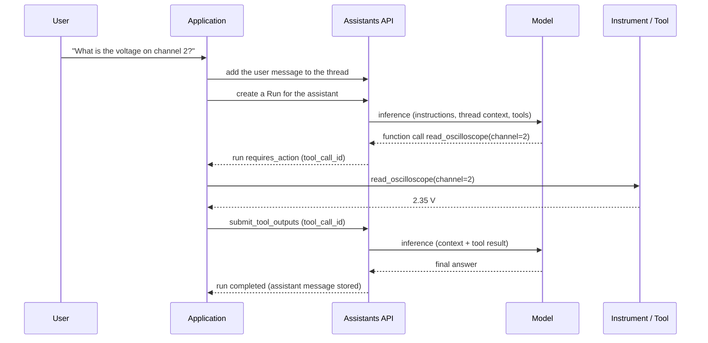

# How the deprecated OpenAI Assistants API worked

The OpenAI Assistants API was a stateful, higher-level API for building AI applications around models, tools, conversation history, and multi-step execution. It was introduced in 2023 and eventually deprecated in favor of the Responses API.

The most important thing to understand is that the Assistants API was not simply a chat-completions endpoint with a conversation ID attached. It introduced a server-side execution model: you defined an assistant, maintained a conversation in a Thread, and asked OpenAI to execute a Run against that Thread. The platform managed the execution lifecycle, tool handoffs, and associated state.

I'll explain the original beta architecture, its object model, the request lifecycle, tool execution, storage, and the implications for implementing an equivalent API layer around an inference engine such as Ollama.

One date clarification: the final Assistants API v2 was officially sunset on August 26, 2026. The older v1 beta had already been discontinued on December 18, 2024. Since the current date is October 2026, the API is no longer available. The explanation below describes how the historical API worked, primarily its v2 form.

## 1. The architecture: five principal objects

The API was organized around persistent configuration, conversation state, execution, and messages.

Assistant — `asst_...`

Model, instructions, tools, defaults

Run references the assistant and thread

Thread — `thread_...`

Persistent conversation and message history

Create a Run to execute the assistant

Run — `run_...`

Execution lifecycle, tool orchestration, results

Messages

User and assistant content

Run steps

Individual execution actions

Conceptual relationship, not a literal database schema. Messages belong to threads; runs operate against threads and produce run steps.

The objects had distinct responsibilities.

| Object              | Responsibility                                 |
| ------------------- | ---------------------------------------------- |
| Assistant           | Reusable AI configuration                      |
| Thread              | Persistent conversation history                |
| Message             | One user or assistant contribution             |
| Run                 | One execution of an assistant against a thread |
| Run step            | An individual operation within a run           |
| File / Vector Store | Uploaded data and retrieval infrastructure     |

The first five formed the core interaction model. Files and vector stores supported additional capabilities, particularly retrieval-augmented generation (RAG).

### 1.1 Assistant: a reusable configuration object

An assistant was not a continuously running AI process. It was a server-side resource describing how an AI should behave when invoked.

For example, an assistant could be configured with:

```
assistant = client.beta.assistants.create(
    name="Engineering Assistant",
    model="gpt-4.1",
    instructions=(
        "You are an electrical engineering assistant. "
        "Explain calculations and show relevant equations."
    ),
    tools=[
        {"type": "code_interpreter"},
        {"type": "file_search"},
    ],
    metadata={"department": "engineering"},
)
```

This is illustrative historical v2 SDK usage; model availability depended on the period and account.

Its configuration could include:

- `name` and `description`: identification and documentation.
- `model`: the model used for inference.
- `instructions`: the persistent behavioral instructions.
- `tools`: built-in tools or declared function tools.
- `tool_resources`: resources available to supported tools, such as vector stores.
- `metadata`: application-defined key-value information.
- Additional generation defaults, such as temperature, token limits, and response formatting where supported.

The important distinction is that creating an assistant did not generate a response. It stored configuration for future runs.

You could create several assistants with different instructions and tools, then invoke them against different threads. You could also modify an assistant's configuration without having to recreate all its conversations.

A thread was not permanently bound to one assistant. The application specified which assistant to use when creating a run. This separation allowed the same conversation history to be used with different assistant configurations, subject to the compatibility of the configuration and thread resources.

### 1.2 Thread: persistent conversation state

A thread was the server-side container for a conversation.

```
thread = client.beta.threads.create(
    messages=[
        {
            "role": "user",
            "content": "Explain the difference between real and reactive power.",
        }
    ]
)
thread_id = thread.id
```

The response included an identifier such as `thread_abc123`.

Subsequent messages were appended to that thread:

```
client.beta.threads.messages.create(
    thread_id=thread_id,
    role="user",
    content="How does power factor relate to them?",
)
```

You did not have to retrieve all the earlier messages and manually send them to the model every time. The platform stored the history and assembled relevant context for runs.

That did not mean the model possessed permanent internal memory. The thread supplied conversation context to individual inference operations. The underlying model still had a finite context window, and the platform could truncate or otherwise select the history supplied to it.

A thread could also contain messages with different content types, including text, images and file references, depending on the model and feature support.

A useful conceptual distinction:

- Thread history: what had been recorded in the conversation.
- Model context: the subset of information actually supplied to the model for a particular inference.
- Assistant configuration: instructions and tools used when executing that inference.

These are three separate things.

### 1.3 Message: a stored conversation item

A message represented an individual contribution to a thread.

A simplified message object looked like this:

```
{
  "id": "msg_example",
  "object": "thread.message",
  "thread_id": "thread_example",
  "role": "user",
  "content": [
    {
      "type": "text",
      "text": {
        "value": "Calculate the impedance of a series RLC circuit."
      }
    }
  ],
  "status": "completed"
}
```

This is a schematic representation, not a complete canonical response.

Important properties included:

- `id`: unique message identifier.
- `thread_id`: parent thread.
- `role`: typically `user` or `assistant`.
- `content`: a list of typed content blocks.
- `created_at`: creation timestamp.
- `attachments`: optional files and tool-resource associations.
- `metadata`: application-defined values.

The `content` array mattered because the API was not limited to a single plain-text string. A message could contain different kinds of content, and consumers needed to inspect the content type rather than assume every message was ordinary text.

Messages could be created, listed, retrieved, and deleted through the relevant endpoints.

There was also a distinction between creating a message and executing the assistant: adding a user message alone did not automatically run the assistant. You normally created a Run afterward.

## 2. Run: the execution engine

The Run was the defining feature of the Assistants API.

With ordinary chat completions, you submitted a request and received a completion. With Assistants, you could create an execution resource that progressed through multiple states, including tool calls and pauses awaiting external work.

For example:

```
run = client.beta.threads.runs.create(
    thread_id=thread_id,
    assistant_id=assistant.id,
)
```

This requested execution of the selected assistant against the selected thread.

A Run captured the execution's effective configuration, including the assistant and thread references, model, instructions and tool settings, as applicable. Run-level settings could override certain assistant defaults.

The Run had its own ID, status, timestamps, error information and usage information where available.

### 2.1 Run lifecycle

queued

Waiting for execution

in_progress

Model inference and orchestration

Tool handoff, if needed

Requires action or a hosted tool operation

completed

failed / cancelled

Simplified lifecycle. Other terminal or intermediate statuses included expired, cancelling and incomplete in applicable versions.

The main statuses were:

| Status            | Meaning                                                                               |
| ----------------- | ------------------------------------------------------------------------------------- |
| `queued`          | The run was waiting to execute                                                        |
| `in_progress`     | Execution was underway                                                                |
| `requires_action` | The application needed to complete an action, typically submit function outputs       |
| `completed`       | Execution finished successfully                                                       |
| `failed`          | Execution failed; inspect `last_error`                                                |
| `cancelling`      | Cancellation was underway                                                             |
| `cancelled`       | Execution was cancelled                                                               |
| `expired`         | The run exceeded an applicable deadline                                               |
| `incomplete`      | Execution did not produce a complete result under the applicable limits or conditions |

A run was therefore a durable, inspectable execution record rather than merely the return value of a model call.

### 2.2 Why it was asynchronous

A run could involve several inference calls, a tool execution, and additional inference afterward. That could take longer than a normal HTTP request should remain open.

The API therefore allowed clients to:

1. Create a run.
2. Receive its ID and current status.
3. Retrieve its status later.
4. Inspect the run's steps.
5. Submit required tool outputs.
6. Retrieve the resulting assistant messages.

A typical polling loop looked like this:

```
import time
from openai import OpenAI
from rich.console import Console
from rich.table import Table

client = OpenAI()
console = Console()

run = client.beta.threads.runs.create(
    thread_id=thread_id,
    assistant_id=assistant.id,
)

while run.status in {"queued", "in_progress", "cancelling"}:
    time.sleep(0.5)
    run = client.beta.threads.runs.retrieve(
        thread_id=thread_id,
        run_id=run.id,
    )

table = Table(title="Assistants API Run")
table.add_column("Field")
table.add_column("Value")
table.add_row("Run ID", run.id)
table.add_row("Status", run.status)
table.add_row("Last error", str(run.last_error))
console.print(table)
```

This is a minimal illustration, not a complete production client: in particular, a run reaching `requires_action` must be handled rather than simply exiting the polling loop and assuming success.

The API also supported streaming, which let clients receive execution events instead of repeatedly polling.

## 3. The tool system: how the assistant actually did work

The Assistants API supported three especially important tool categories in its v2 form:

- `code_interpreter`: execute Python in an OpenAI-hosted environment.
- `file_search`: retrieve relevant information from uploaded documents using vector stores.
- `function`: request execution of a function implemented by the developer.

The critical distinction is that these tools did not all execute in the same place.

| Tool             | Who executed it? | What the API did                                                              |
| ---------------- | ---------------- | ----------------------------------------------------------------------------- |
| Code Interpreter | OpenAI           | Ran Python in a hosted execution environment                                  |
| File Search      | OpenAI           | Searched indexed documents and supplied relevant material                     |
| Function calling | Your application | Returned a structured function request and waited for your code to execute it |

The API was an orchestration layer around inference and tools, not a universal execution environment for arbitrary developer functions.

### 3.1 Function calling: the complete handoff cycle

This is probably the most important feature to understand if you're implementing an API-compatible inference harness.

Imagine an assistant that can query a laboratory instrument. You declare a function called `read_oscilloscope`, and the model decides when it should be used.

You register the function's schema with the assistant:

```
tools = [
    {
        "type": "function",
        "function": {
            "name": "read_oscilloscope",
            "description": "Read the current voltage from an oscilloscope channel.",
            "parameters": {
                "type": "object",
                "properties": {
                    "channel": {
                        "type": "integer",
                        "description": "Oscilloscope channel number.",
                    }
                },
                "required": ["channel"],
                "additionalProperties": False,
            },
            "strict": True,
        },
    }
]
```

The declaration tells the model what the function does, which arguments it accepts, and the expected argument structure. It does not implement the function.

The complete lifecycle worked as follows.

STEP 1

User asks a question

"What is the voltage on channel 2?"

STEP 2

The model requests a function

`read_oscilloscope({"channel": 2})`

The model returns a structured tool call, not the measured voltage.

STEP 3

The Run pauses

Status becomes `requires_action`. The API reports the pending function call and its `tool_call_id`.

STEP 4

Your application executes the function

Your Python code communicates with the oscilloscope and obtains, for example, `2.35 V`.

STEP 5

Your application submits the result

It sends the output and matching `tool_call_id` to the API.

STEP 6

The model resumes

The assistant receives the tool result, interprets it, and generates a user-facing answer.

Notice that this was one Run, potentially involving multiple model calls. The tool handoff did not necessarily finish the Run.

#### What `requires_action` actually meant

Suppose the Run response contained a `required_action` object resembling this:

```
{
  "type": "submit_tool_outputs",
  "submit_tool_outputs": {
    "tool_calls": [
      {
        "id": "call_abc123",
        "type": "function",
        "function": {
          "name": "read_oscilloscope",
          "arguments": "{\"channel\":2}"
        }
      }
    ]
  }
}
```

This is a simplified example of the response structure.

The application had to:

1. Read the pending tool calls.
2. Parse each function's JSON arguments.
3. Find the corresponding implementation.
4. Execute it.
5. Serialize the result into a string.
6. Submit the output against the original tool-call ID.

For example:

```
result = client.beta.threads.runs.submit_tool_outputs(
    thread_id=thread_id,
    run_id=run.id,
    tool_outputs=[
        {
            "tool_call_id": "call_abc123",
            "output": '{"voltage_v": 2.35}',
        }
    ],
)
```

The output could be JSON encoded as a string, plain text, or another suitable representation for the function's result. The important part was the association between the result and the original call.

The API did not execute your Python function. It provided the function declaration to the model, exposed the model's request, and accepted the result from your application. OpenAI's documentation explicitly distinguished function selection and argument generation from execution of third-party functions.

#### Multiple tool calls

A model could request multiple function calls in one response, including parallel calls where supported.

For example, it might request voltage measurements on channels 1 and 2. Your application would receive both calls and could execute them independently if the operations permitted it.

You would submit their outputs together, each paired with its own call ID.

The model would then continue with those results in context.

This is why a correct implementation should not assume there is exactly one tool call per Run. It also should not assume that every Run will require tools.

### 3.2 Run steps: the execution trace

Runs had a corresponding set of Run Step objects. These represented the operations performed during execution.

Typical step types included:

- `message_creation`: an assistant message was created.
- `tool_calls`: the assistant invoked one or more tools.

A simplified trace might look like this:

| Step | Type               | Result                         |
| ---- | ------------------ | ------------------------------ |
| 1    | `tool_calls`       | Requested voltage measurement  |
| 2    | `message_creation` | Produced the final explanation |

In a more complex execution, there could be multiple tool-call steps and messages.

Run steps were useful for debugging because the final answer alone did not reveal the full execution history. A developer could inspect the step records to understand which tool had been called, what arguments had been generated, and what execution had occurred.

However, Run Steps were an execution trace, not a complete record of every internal model operation. They exposed the API's supported step-level events and details.

### 3.3 Code Interpreter: hosted computation

Code Interpreter was different from function calling.

When an assistant had the `code_interpreter` tool enabled, the model could request calculations or data analysis, and OpenAI executed the generated Python code in its hosted environment.

For example, a user could upload experimental measurements and request:

- Regression and curve fitting.
- Statistical analysis.
- Numerical integration.
- Plot generation.
- Data transformations.

The model could write and execute code, inspect the results, correct its approach, and continue reasoning.

The developer did not have to implement a function for every possible mathematical operation. The tool provided a general-purpose computational environment.

The execution environment was nevertheless separate from your own computer. It did not automatically have access to your local Python packages, filesystem, hardware or network resources.

Code Interpreter could also generate files, such as plots or processed datasets, which could be returned through the API's file mechanisms.

### 3.4 File Search: retrieval-augmented generation

File Search was the other major hosted tool.

The typical process was:

1. Upload documents through the Files API.
2. Create or populate a vector store.
3. Associate the vector store with an assistant or thread.
4. Enable `file_search` in the assistant's tools.
5. Run the assistant on a question involving those documents.
6. Let the hosted retrieval system search for relevant passages and supply them to the model.

The retrieval system handled document parsing, chunking, embeddings and search.

The documented default configuration for v2 included:

| Setting                         | Default                  |
| ------------------------------- | ------------------------ |
| Chunk size                      | 800 tokens               |
| Chunk overlap                   | 400 tokens               |
| Embedding model                 | `text-embedding-3-large` |
| Embedding dimensions            | 256                      |
| Maximum chunks added to context | 20                       |

These are the historical documented defaults, not guarantees about every later configuration or the current Responses API.

The architecture matters: the model did not need to ingest every uploaded document in every Run. Instead, retrieval selected relevant chunks to provide as context.

For instance, an assistant answering questions about an instrument's manual could search the relevant passages rather than placing the entire manual in every prompt.

The vector store was persistent infrastructure; a single search operation was part of an execution. They were separate resources with different lifecycles.

## 4. The complete request lifecycle

Let's connect the pieces into a concrete sequence.

Suppose you are building a technical assistant that can answer questions about an oscilloscope and query the instrument when necessary.

### Initial setup

You create an Assistant containing the model, instructions and function schema. You also create a Thread for the user.

The IDs might be:

- `asst_123`: assistant configuration.
- `thread_456`: conversation.
- `msg_789`: user message.
- `run_abc`: execution.

These IDs are illustrative.

### Request sequence



The sequence contains several different kinds of state:

- Conversation state lives in the Thread and its Messages.
- Configuration lives in the Assistant and applicable Run settings.
- Execution state lives in the Run.
- Execution details live in Run Steps.
- Tool results are returned to the Run and become available to subsequent model inference.

### A practical state-machine interpretation

A useful way to implement the Run lifecycle is as a state machine:

```
from enum import StrEnum

class RunStatus(StrEnum):
    QUEUED = "queued"
    IN_PROGRESS = "in_progress"
    REQUIRES_ACTION = "requires_action"
    COMPLETED = "completed"
    FAILED = "failed"
    CANCELLING = "cancelling"
    CANCELLED = "cancelled"
    EXPIRED = "expired"
    INCOMPLETE = "incomplete"

TERMINAL_STATUSES = {
    RunStatus.COMPLETED,
    RunStatus.FAILED,
    RunStatus.CANCELLED,
    RunStatus.EXPIRED,
    RunStatus.INCOMPLETE,
}

def classify_run(status: str) -> str:
    status = RunStatus(status)
    if status in TERMINAL_STATUSES:
        return "terminal"
    if status == RunStatus.REQUIRES_ACTION:
        return "awaiting_external_action"
    return "active"
```

This is an illustrative implementation of the conceptual state model, not a complete reproduction of the historical API's validation rules.

The crucial point is that `requires_action` is not equivalent to `completed`. It means execution has paused pending a required external operation. Treating it as a terminal success would break the tool loop.

Likewise, a client should not treat every non-active state as success: it needs to distinguish completion, failure, cancellation, expiration and incomplete execution.

## 5. What else the API managed

The five core objects explain the execution model, but the historical API included additional lifecycle and configuration behavior.

### 5.1 Run-level configuration and overrides

When creating a Run, you could override certain assistant defaults. Relevant parameters included:

- `model`: model selection.
- `instructions`: instructions for this particular run.
- `additional_instructions`: extra instructions appended to the existing instructions.
- `tools`: tools available to the run.
- `tool_choice`: whether tool use was automatic, required, or constrained to a particular tool where supported.
- `temperature` and `top_p`: sampling configuration where supported.
- `max_prompt_tokens` and `max_completion_tokens`: token limits.
- `response_format`: output format, including JSON mode where supported.
- `metadata`: run-specific application data.

This allowed the same Assistant to behave differently for individual runs without necessarily modifying its persistent configuration.

One subtlety: the effective instructions and tools used by a Run were not always identical to the Assistant's stored defaults. A faithful implementation needs to preserve the distinction between persistent configuration and per-run overrides.

### 5.2 Context-window management

Thread persistence did not mean unlimited model context.

The API managed the selection and truncation of conversation history when the conversation exceeded the model's context capacity. Run parameters could also constrain how many tokens were allocated to the prompt and completion.

The practical distinction is:

- The Thread was the durable conversation record.
- The prompt was the context assembled for inference.
- Token limits constrained what the model could process or generate during execution.

An implementation that simply sends every historical message to the model on every request is not equivalent to a system that can manage long conversations.

It can also become computationally expensive: if every request reprocesses the entire transcript, prompt-processing cost grows with conversation length.

### 5.3 Streaming

The API supported streaming so that clients could receive events as execution progressed.

Rather than waiting for the Run to complete and retrieving its final state, an application could consume events associated with such things as:

- Run creation and progress.
- Assistant message creation.
- Text deltas.
- Tool-call information.
- Run completion or failure.

This made it possible to show generated text incrementally and expose progress to the user.

Streaming was not merely a faster way to retrieve the final answer. It provided an event-oriented view of the execution lifecycle.

### 5.4 Files and attachments

Files had their own lifecycle, separate from Threads and Runs.

A file could be uploaded, associated with a message, or used by a hosted tool. For example, a user might attach a CSV file to a message and ask Code Interpreter to analyze it.

A file attachment and a vector-store association were not interchangeable:

- An attachment made a file available through the relevant message or tool mechanism.
- A vector store supported indexed retrieval across documents.
- A Run determined when the assistant actually used the available resources.

The historical API imposed documented limits, including a 512 MB maximum per file and 5 million tokens per file, alongside vector-store limits. These were limits for the documented v2 implementation, not general properties of all OpenAI file APIs.

### 5.5 Expiration and failure

Runs could fail, expire or become incomplete. In particular, a Run waiting for an external tool output could not simply remain suspended indefinitely.

Applications needed to handle:

- Model or infrastructure errors.
- Invalid function arguments or failed tool execution.
- Missing or rejected tool outputs.
- Token-limit-related incomplete execution.
- Cancellation and expiration.

The correct behavior was to inspect the Run status and error details, rather than infer success from the fact that the request to create a Run returned successfully.

Creating a Run successfully meant that the execution resource was created. It did not guarantee that the requested task would complete successfully.

## 6. What the original v1 beta and v2 changed

The phrase Assistants API beta is somewhat ambiguous because there were two relevant generations.

| Aspect               | Earlier v1 beta                        | Later v2                               |
| -------------------- | -------------------------------------- | -------------------------------------- |
| API version          | Earlier beta                           | `OpenAI-Beta: assistants=v2`           |
| Conversation model   | Assistants, Threads, Messages and Runs | Same core object model                 |
| Retrieval            | Earlier Retrieval tool model           | `file_search` and vector stores        |
| Function calling     | Supported                              | Supported, with the mature v2 workflow |
| Current availability | Discontinued December 18, 2024         | Sunset August 26, 2026                 |

The v2 API was not a completely different product. It retained the core Assistant–Thread–Run model while modernizing tools and retrieval infrastructure.

The v1 API was discontinued well before the final v2 sunset.

## 7. Why OpenAI deprecated it

The Assistants API was an early attempt to make agentic applications easier to build by giving developers a server-managed assistant configuration, persistent conversation history, and a multi-step execution engine.

Its fundamental idea remained useful. The issue was the API's particular abstraction and execution model.

The later Responses API consolidated several capabilities and introduced a more flexible interaction model.

OLD MODEL

Assistant + Thread + Run

Configuration and conversation were separate resources. An application explicitly created Runs and handled the execution lifecycle, including tool handoffs.

NEW MODEL

Prompt + Conversation + Response

Prompts hold reusable configuration, Conversations hold persistent items, and Responses execute model requests with typed inputs and outputs.

The migration guide describes the mapping as follows.

| Assistants API | Responses-era equivalent | Conceptual change                                         |
| -------------- | ------------------------ | --------------------------------------------------------- |
| Assistant      | Prompt                   | Reusable behavior and tool configuration                  |
| Thread         | Conversation             | Persistent sequence of items, not just messages           |
| Run            | Response                 | Request execution and output                              |
| Run Step       | Item                     | Generalized representation of messages, calls and outputs |

There are important differences beneath this mapping.

First, configuration became more explicitly versioned. The migration guide describes the new Prompt resources as dashboard-managed, versionable configurations rather than Assistant resources created and updated entirely through the API.

Second, conversations became more general. A Thread primarily stored messages. A Conversation can contain typed items representing messages, tool calls, tool outputs and other information.

Third, execution became more flexible. The Responses API can return structured output items and tool calls, while applications can choose how to continue the workflow. The API also offers hosted tools such as web search, file search and computer use.

Fourth, the new design separates the model's output from the application's orchestration more clearly. The Responses API supports persistent Conversations and response chaining, but applications can also manage the history and tool loop themselves.

OpenAI announced the final sunset date as August 26, 2026. The Assistants API is no longer available as of the current date.

## 8. What this architecture means for your own inference API

For an inference harness backed by Ollama, the useful lesson is that the Assistants API was a stateful orchestration service built on top of model inference, not a special model architecture.

You can reproduce much of its core behavior locally without copying every feature.

Configuration store

Assistant definitions: model, instructions, tool schemas, generation defaults and metadata.

Conversation store

Threads and messages, with durable ordering and content types.

Run orchestrator

State transitions, inference requests, tool-call dispatch, retries, cancellation and completion.

Inference and tools

Ollama or another backend, application-defined functions, and optional retrieval or code-execution services.

I would prioritize the following implementation details.

### A. Make Runs first-class resources

Do not implement a Run as a thin wrapper that immediately returns whatever Ollama generated.

A Run needs an identifier, a status, timestamps, an execution record, and a way to retrieve its current state. Even if inference happens synchronously internally, the resource model should remain coherent.

That provides a foundation for polling, streaming, tool handoffs, retries and future background execution.

### B. Persist messages independently of Runs

A message is a conversation record. A Run is an execution that consumes context and produces results.

Do not conflate them in the database. A user message can exist before a Run is created, and a Run can fail after that message has been stored.

Likewise, a single Run can produce multiple assistant messages or tool operations.

### C. Implement tool calling as a resumable state machine

This is the most important functional requirement beyond ordinary inference.

Your implementation should:

1. Receive the model's output.
2. Determine whether it contains tool calls.
3. Record the calls and move the Run into an awaiting-action state.
4. Execute the functions in the application layer.
5. Store their outputs, correlated by call ID.
6. Resume inference with the tool results.
7. Repeat if another tool call is requested.
8. Complete or fail the Run.

Do not assume that one inference call equals one Run. That assumption is incompatible with the defining execution model of the Assistants API.

### D. Keep hosted-tool abstractions separate from function calling

The original API's `file_search`, `code_interpreter` and `function` tools represented different execution arrangements.

If your implementation supports custom functions, that does not automatically mean it implements file search or code execution. Each capability needs its own backend and lifecycle.

A clean architecture can expose all three through a common tool interface while allowing their implementations to differ.

### E. Treat the model backend as replaceable

The Assistant configuration should refer to a model identifier, not embed assumptions about Ollama's specific request format.

The orchestrator can translate the application's internal representation into Ollama's inference request and normalize the result back into your API's output schema.

This separation makes it possible to support several model providers without redesigning Threads, Messages or Runs.

### F. Preserve execution observability

The Run and Run Step concepts are valuable even for a local-only application.

For every Run, you should be able to determine:

- Which model and configuration were used.
- Which messages were included in the inference context.
- Which tool calls were requested.
- Which tool implementations ran.
- What outputs they returned.
- Why the Run completed, failed or stopped.
- How many inference attempts and tool cycles occurred.

That is particularly useful when a small local model produces malformed tool arguments or repeatedly requests the same operation.

## 9. The central takeaway

The old Assistants API can be understood as three systems connected together:

1. A configuration system: Assistants defined reusable model and tool behavior.
2. A persistence system: Threads and Messages stored the conversation independently of individual inference calls.
3. An execution system: Runs managed multi-step inference, tool handoffs, lifecycle state and completion.

Its defining innovation was not persistent chat history by itself. It was the combination of persistent conversation state with a server-managed, inspectable execution lifecycle.

For an Ollama-backed API, implementing the Assistant and Thread objects is relatively straightforward. The more consequential engineering work is the Run state machine, the resumable tool-call protocol, and the distinction between stored conversation history and the context actually sent to the model.

Those are the parts that turn a conventional inference endpoint into an agent-oriented API.